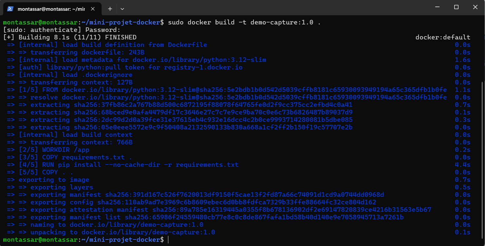
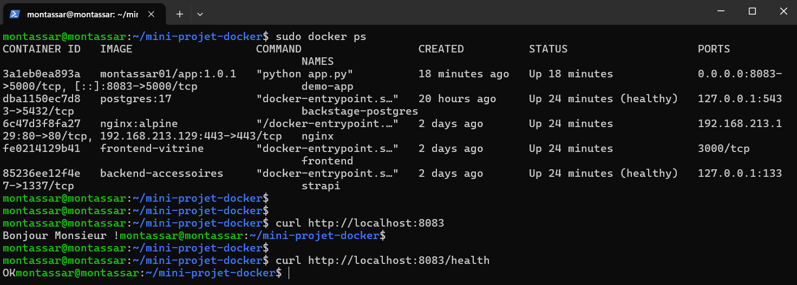
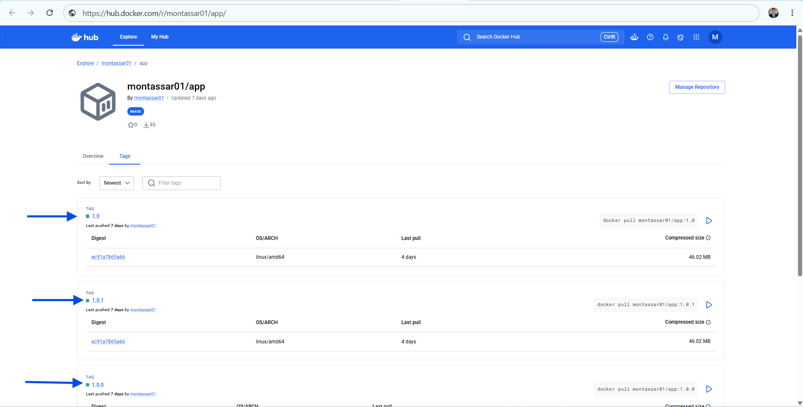

# Application Flask configurable (mini-projet Docker)

Petite application web Flask qui affiche un message d'accueil.
Le message se configure par une variable d'environnement, sans reconstruire l'image.

## Image Docker Hub

`montassar01/app`

| Tag | Description |
|---|---|
| `1.0.0` | Première version |
| `1.0.1` | Ajoute la route `/health` |
| `1.0` | Alias qui suit la dernière version 1.0.x (actuellement 1.0.1) |

## Prérequis

- Docker installé et démarré (`docker --version`)
- Un port libre sur la machine (8082 dans les exemples)

## Lancer l'application (image publiée uniquement)

    docker run -d --name monapp -p 8082:5000 \
      -e APP_MESSAGE="Bonjour !" \
      --memory 256m --cpus 0.5 \
      montassar01/app:1.0.1

Puis tester :

    curl http://localhost:8082
    curl http://localhost:8082/health

## Variables d'environnement

| Variable | Valeur par défaut | Rôle |
|---|---|---|
| `APP_MESSAGE` | `Bonjour depuis le conteneur !` | Message renvoyé par la page d'accueil |

## Routes

- `/` : renvoie le message d'accueil
- `/health` : renvoie `OK` (disponible à partir de la version 1.0.1)

## Construire l'image soi-même

    git clone https://github.com/MontassarHannachi/mini-projet-docker.git
    cd mini-projet-docker
    docker build -t montassar01/app:1.0.1 .

## Arrêter et supprimer le conteneur

    docker rm -f monapp

## Résultat attendu

- `curl http://localhost:8082` affiche le message défini par `APP_MESSAGE` (ici `Bonjour !`).
- `curl http://localhost:8082/health` affiche `OK`.

## Dépannage

- Voir les journaux : `docker logs monapp`.
## 10. Captures d'écran

Les captures suivantes illustrent les principales étapes de réalisation, de construction et de vérification de l'application Docker.

### 10.1 Configuration Docker

### 10.2 Construction de l'image Docker

### 10.3 Exécution et tests HTTP

### 10.4 Publication sur Docker Hub

