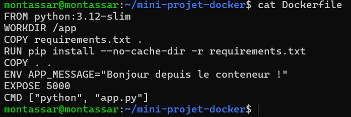

# Application Flask conteneurisée avec Docker

[](https://www.docker.com/)
[](https://www.python.org/)
[](https://flask.palletsprojects.com/)

## 1. Présentation du projet

Ce projet consiste à conteneuriser une application web développée avec **Flask**, à construire une image Docker et à la publier sur **Docker Hub**.

L'application affiche un message d'accueil configurable à l'aide d'une variable d'environnement, sans nécessiter de reconstruction de l'image.

Le projet met en pratique les principales étapes du cycle de vie d'une application conteneurisée : construction, exécution, configuration, test et publication.

## 2. Technologies utilisées

- **Python 3.12** : langage de programmation.
- **Flask 3.0.3** : framework web.
- **Docker** : conteneurisation de l'application.
- **Docker Hub** : hébergement et distribution de l'image.

## 3. Image Docker publiée

L'image est disponible publiquement sur Docker Hub :

**Repository :** [montassar01/app](https://hub.docker.com/r/montassar01/app)

| Tag | Description |
|---|---|
| `1.0.0` | Première version de l'application. |
| `1.0.1` | Ajout du point de terminaison `/health`. |
| `1.0` | Alias actuellement associé à la même image que `1.0.1`. |

## 4. Prérequis

Avant de lancer l'application, il faut disposer de :

- Docker installé et démarré.
- Une connexion Internet pour télécharger l'image publiée.
- Un port disponible sur la machine hôte (8082 dans les exemples ci-dessous).

Vérifier l'installation de Docker :

```bash
docker --version
```

## 5. Télécharger et exécuter l'application

### 5.1 Télécharger l'image depuis Docker Hub

```bash
docker pull montassar01/app:1.0.1
```

### 5.2 Démarrer le conteneur

```bash
docker run -d \
  --name monapp \
  -p 8082:5000 \
  -e APP_MESSAGE="Bonjour !" \
  --memory 256m \
  --cpus 0.5 \
  montassar01/app:1.0.1
```

**Explication des principaux paramètres :**

| Paramètre | Description |
|---|---|
| `-d` | Exécute le conteneur en arrière-plan. |
| `--name monapp` | Attribue le nom `monapp` au conteneur. |
| `-p 8082:5000` | Associe le port 8082 de l'hôte au port 5000 du conteneur. |
| `-e APP_MESSAGE="Bonjour !"` | Définit le message affiché par l'application. |
| `--memory 256m` | Limite la mémoire à 256 Mio. |
| `--cpus 0.5` | Limite l'utilisation à 0,5 CPU. |

## 6. Configuration de l'application

L'application utilise une variable d'environnement pour personnaliser le message d'accueil.

| Variable | Valeur par défaut | Description |
|---|---|---|
| `APP_MESSAGE` | `Bonjour depuis le conteneur !` | Message affiché sur la page d'accueil. |

Cette configuration permet de modifier le comportement de l'application sans reconstruire l'image Docker.

## 7. Points de terminaison HTTP

L'application expose deux routes :

| Route | Méthode HTTP | Résultat attendu |
|---|---|---|
| `/` | GET | Affiche le message d'accueil configuré. |
| `/health` | GET | Retourne `OK` pour vérifier la disponibilité de l'application. |

La route `/health` est disponible à partir de la version `1.0.1`.

### Vérification du fonctionnement

Tester la page d'accueil :

```bash
curl http://localhost:8082
```

Résultat attendu :

```text
Bonjour !
```

Tester le point de terminaison de santé :

```bash
curl http://localhost:8082/health
```

Résultat attendu :

```text
OK
```

Vérifier l'état du conteneur :

```bash
docker ps
```

Consulter les journaux :

```bash
docker logs monapp
```

## 8. Construire l'image localement

Il est également possible de récupérer le code source et de construire l'image Docker localement.

Cloner le dépôt GitHub :

```bash
git clone https://github.com/MontassarHannachi/mini-projet-docker.git
```

Accéder au répertoire du projet :

```bash
cd mini-projet-docker
```

Construire l'image :

```bash
docker build -t app-flask:local .
```

Cette commande construit une image locale à partir du Dockerfile du projet, sans télécharger l'image publiée comme étape obligatoire.

## 9. Arrêter et supprimer le conteneur

Arrêter le conteneur :

```bash
docker stop monapp
```

Supprimer le conteneur arrêté :

```bash
docker rm monapp
```

**Remarque :** ces commandes concernent uniquement le conteneur créé avec le nom `monapp`. Elles ne suppriment pas l'image Docker.

## 10. Dépannage

| Problème | Solution |
|---|---|
| Le port 8082 est déjà utilisé. | Choisir un autre port disponible dans la commande `-p`. |
| Le conteneur ne démarre pas. | Vérifier son état avec `docker ps -a`. |
| L'application ne répond pas. | Consulter les journaux avec `docker logs monapp`. |
| Le conteneur existe déjà. | Vérifier son nom avec `docker ps -a` avant de le supprimer ou de le réutiliser. |

## 11. Captures d'écran

Les captures suivantes présentent les principales étapes de réalisation et de validation du projet.

### 11.1 Configuration du Dockerfile



### 11.2 Construction de l'image Docker


### 11.3 Exécution du conteneur et tests HTTP


### 11.4 Publication de l'image sur Docker Hub


## 12. Auteur

**Montassar Hannachi**

Projet réalisé dans le cadre d'un mini-projet pédagogique sur la conteneurisation et la publication d'une application web avec Docker.

- **GitHub :** [MontassarHannachi](https://github.com/MontassarHannachi)
- **Docker Hub :** [montassar01](https://hub.docker.com/u/montassar01)

---

*Projet réalisé à des fins pédagogiques.*
