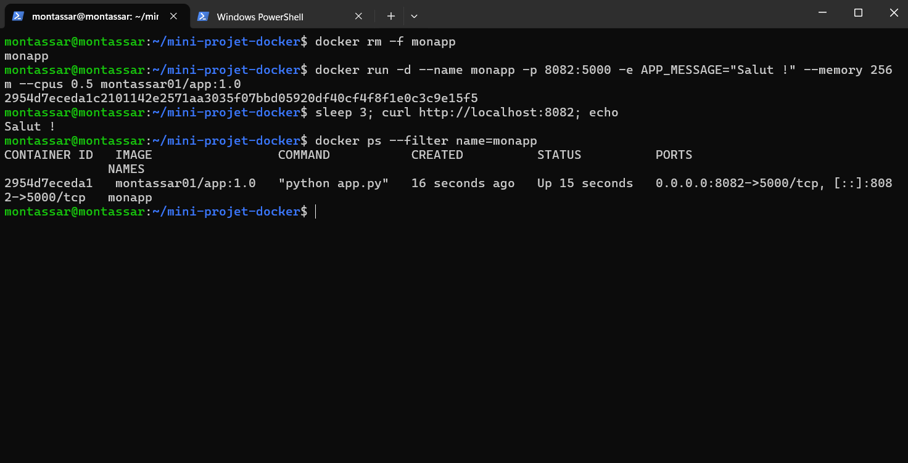
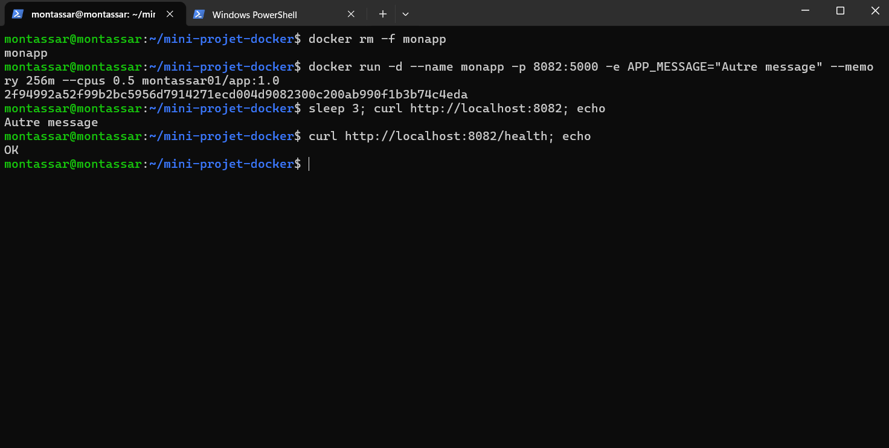
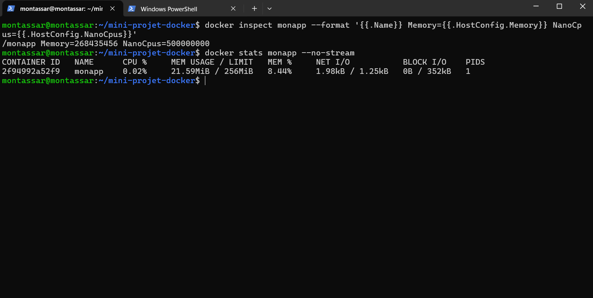
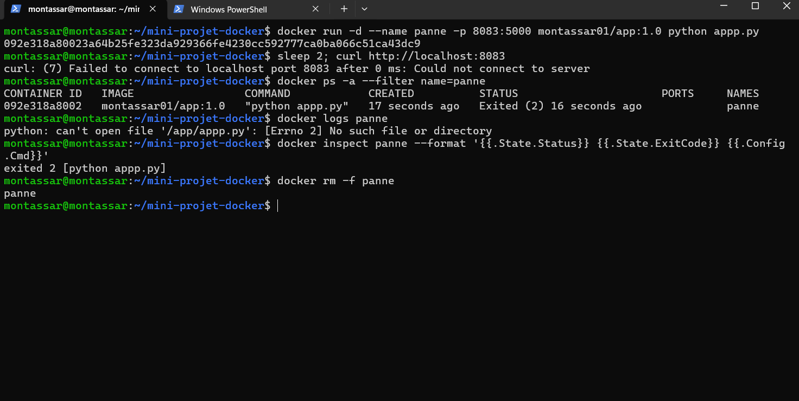
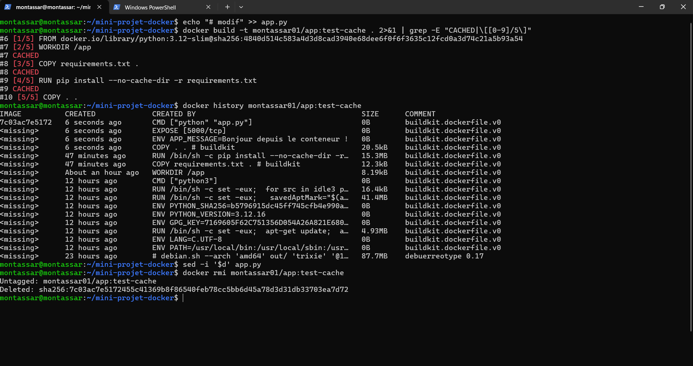
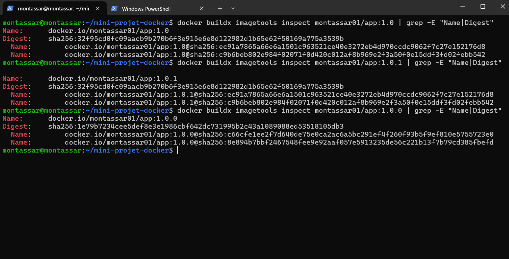
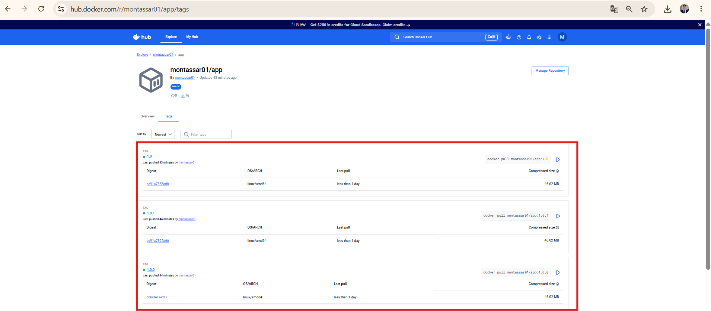

# Compte rendu : Mini-projet 1 Docker

Image : `montassar01/app` (1.0.0, 1.0.1, 1.0) | Dépôt : https://github.com/MontassarHannachi/mini-projet-docker

## Réponses aux questions

**Étape 0.** Le Dockerfile décrit comment construire l'application : il dépend du code et doit évoluer avec lui. Les versionner ensemble garantit qu'un commit donné produit toujours la même image.

**Étape 1.** Une variable d'environnement permet de changer le comportement (ici `APP_MESSAGE`) sans reconstruire l'image : la même image sert pour tous les environnements, et la configuration reste séparée du code et des secrets.

**Étape 2.** `FROM`, `WORKDIR`, `COPY` et `RUN` créent des couches (visibles avec leur taille dans `docker history`). `ENV`, `EXPOSE` et `CMD` n'ajoutent que des métadonnées (0 B).

**Étape 3.** Limites fixées : `--memory 256m` et `--cpus 0.5`. Vérification : `docker inspect` renvoie `268435456` (octets) et `500000000` (NanoCpus), et `docker stats` affiche `21.43MiB / 256MiB`.

**Étape 4.** Symptôme : `curl` renvoie `Connection reset by peer`. Investigation : `docker ps -a`, puis `docker logs` (`can't open file '/app/appp.py'`), puis `docker inspect` (`exited 2`). Cause racine : nom de fichier erroné dans la commande de démarrage.

**Étape 5.** Si on copiait tout le code avant d'installer les dépendances, chaque modification du code invaliderait le cache et `pip install` serait refait à chaque build.

**Étape 6.** Un tag de version précise (`1.0.0`) doit rester immuable : des déploiements et des collègues comptent sur lui pour obtenir exactement la même image. Seuls les alias (`1.0`) sont faits pour être déplacés.

**Étape 7.** Informations manquantes lors du premier essai : à compléter après le test de l'autre binôme.

## Tableau d'observation du cache (seul `app.py` modifié)

| Étape | Instruction | État |
|---|---|---|
| 2/5 | WORKDIR /app | CACHED |
| 3/5 | COPY requirements.txt . | CACHED |
| 4/5 | RUN pip install ... | CACHED (0,0 s contre 14 s au premier build) |
| 5/5 | COPY . . | exécutée de nouveau |

## Preuves

- E6 : `curl http://localhost:8082` renvoie `Salut !` puis `Autre message` selon `APP_MESSAGE`, sans reconstruction.
- E7 : sorties de `docker inspect` et `docker stats` ci-dessus.
- E8 : `1.0.1` et `1.0` ont le même digest (`sha256:32f95c...`), `1.0.0` a le sien (`sha256:1e79b7...`).

## Difficultés rencontrées et enseignements

Ports 8080 et 8081 déjà occupés par d'anciens conteneurs (`port is already allocated`) : j'ai utilisé le 8082. `curl` lancé trop tôt après `docker run` : l'application n'avait pas fini de démarrer. Échec du `docker login` puis de l'authentification GitHub (identifiant et jeton erronés), résolu par une clé SSH. Enseignement : toujours vérifier `docker ps` avant de choisir un port, et lire `docker logs` avant de conclure à une panne.

## Preuves (captures)

### E6 : configuration par variable d'environnement
Message `Salut !` puis `Autre message`, sans reconstruire l'image.

### E7 : limites de ressources
`Memory=268435456` (256 Mo), `NanoCpus=500000000` (0,5 CPU), `21.59MiB / 256MiB`.

### Étape 4 : panne et diagnostic
Symptôme : `curl` échoue. Cause racine : fichier `appp.py` inexistant dans `CMD`.

### Étape 5 : observation du cache

### E8 : versions et digests
`1.0` et `1.0.1` partagent le digest `32f95c...`, `1.0.0` a le digest `1e79b7...`. Docker Hub affiche le digest de la plateforme `linux/amd64` (`ec91a7865a66` pour `1.0` et `1.0.1`, `c66cfe1ee2f7` pour `1.0.0`), qui correspond aux lignes `@sha256:ec91a...` et `@sha256:c66cfe...` de la commande `imagetools`.

## Annexe : préparation de l'environnement

