# Compte rendu : Mini-projet 1 Docker

**Image Docker :** `montassar01/app` (versions `1.0.0`, `1.0.1`, `1.0`)  
**Dépôt GitHub :** https://github.com/MontassarHannachi/mini-projet-docker

Projet réalisé individuellement, sans binôme.

## Réponses aux questions

### Étape 0 — Rôle du Dockerfile

Le Dockerfile décrit les instructions nécessaires à la construction de l'image Docker de l'application. Il définit notamment l'image de base, le répertoire de travail, les dépendances à installer, les fichiers à copier et la commande de démarrage.

Il doit être versionné avec le code source dans le dépôt Git afin de garantir la traçabilité des modifications et de faciliter la reproduction de la construction. La reproductibilité exacte dépend également de la stabilité des images de base et des dépendances utilisées.

### Étape 1 — Variables d'environnement

Une variable d'environnement permet de modifier le comportement de l'application sans reconstruire l'image. Dans ce projet, la variable `APP_MESSAGE` permet de changer le message affiché.

La même image peut ainsi être utilisée dans plusieurs environnements, tandis que la configuration reste séparée du code. Toutefois, les variables d'environnement ne constituent pas, à elles seules, un mécanisme sécurisé de gestion des secrets.

### Étape 2 — Couches Docker

Les instructions `FROM`, `WORKDIR`, `COPY` et `RUN` participent à la construction du système de fichiers de l'image et peuvent générer des couches (*layers*).

En revanche, les instructions `ENV`, `EXPOSE` et `CMD` définissent principalement la configuration et les métadonnées de l'image, sans créer de couche contenant de nouvelles données du système de fichiers.

La commande `docker history` permet de consulter l'historique des instructions et les informations relatives aux couches.

### Étape 3 — Limites de ressources

La valeur `268435456` octets correspond à 256 Mio (256 × 1024 × 1024 octets).

La valeur `NanoCpus=500000000` correspond à une limite de 0,5 CPU.

La commande `docker stats --no-stream monapp` a affiché une consommation mémoire de `21.59MiB / 256MiB` au moment de la capture.

Cette valeur représente une mesure instantanée de l'utilisation mémoire et non la limite configurée.

### Étape 4 — Diagnostic d'une panne

**Symptôme :** la commande `curl` renvoie `Failed to connect to localhost port 8083` et le conteneur apparaît avec le statut `Exited (2)`.

**Investigation :**
- `docker ps -a` permet de constater que le conteneur est arrêté.
- `docker logs` affiche l'erreur `can't open file '/app/appp.py'`.
- `docker inspect` confirme le code de sortie `2`.

**Cause racine :** le nom du fichier indiqué dans la commande de démarrage est incorrect. Le fichier `appp.py` n'existe pas dans le conteneur.

Cette erreur empêche le lancement de l'application.

### Étape 5 — Optimisation du cache Docker

Si tous les fichiers du projet étaient copiés avant l'installation des dépendances, chaque modification du code pourrait invalider le cache de cette étape.

Par conséquent, `pip install` serait exécuté de nouveau à chaque construction, même si les dépendances n'ont pas changé.

La séparation entre `COPY requirements.txt .` et `COPY . .` permet de conserver en cache l'installation des dépendances lorsque seul le code source est modifié.

### Étape 6 — Tags et digests

Un tag Docker est une référence modifiable : techniquement, il peut être associé à une autre image lors d'une publication ultérieure.

Il est possible d'adopter une convention consistant à ne jamais déplacer un tag de version précis comme `1.0.0`, mais cette immuabilité relève d'une règle de publication et n'est pas garantie par le tag lui-même.

Les digests des index d'image publiés sont les suivants :

| Tag | Digest de l'index |
|---|---|
| `1.0.0` | `sha256:1e79b7234cee5def8e3e1986cbf642dc731995b2c43a1089088ed53518105db3` |
| `1.0.1` | `sha256:32f95cd0fc09aacb9b270b6f3e915e6e8d122982d1b65e62f50169a775a3539b` |
| `1.0` | `sha256:32f95cd0fc09aacb9b270b6f3e915e6e8d122982d1b65e62f50169a775a3539b` |

Il faut distinguer le digest de l'index d'image multi-plateforme du digest du manifeste correspondant à une plateforme donnée, par exemple `linux/amd64`.

Ce sont deux identifiants de niveaux différents ; leurs valeurs peuvent donc être différentes.

### Étape 7 — Test du README

Travaillant seul, je n'ai pas pu faire tester le README par un autre binôme. J'ai donc simulé le test en supprimant les images locales (`docker rmi`), puis en lançant l'application en suivant uniquement la commande de la section « Lancer l'application » du README.

Lors de ce premier essai, plusieurs informations manquaient :

1. Les prérequis : Docker installé et démarré, port disponible.
2. Le résultat attendu des commandes, afin de vérifier que le lancement a réussi.
3. Le délai de démarrage : un `curl` lancé immédiatement après `docker run` peut échouer avec `Connection reset by peer`.
4. La conduite à tenir lorsqu'un port est déjà utilisé (`port is already allocated`).

J'ai ajouté au README les sections « Prérequis », « Résultat attendu » et « Dépannage ».

**Limite :** un test réalisé par moi-même est moins indépendant et moins fiable qu'un test effectué par une personne extérieure qui ne connaît pas le projet.

## Tableau d'observation du cache

Modification effectuée : seul le fichier `app.py` a été modifié.

| Étape | Instruction | État |
|---|---|---|
| 2/5 | `WORKDIR /app` | CACHED |
| 3/5 | `COPY requirements.txt .` | CACHED |
| 4/5 | `RUN pip install ...` | CACHED (0,0 s contre 14 s au premier build) |
| 5/5 | `COPY . .` | Réexécutée |

Cette observation confirme que les couches liées aux dépendances sont conservées en cache lorsque seul le code de l'application est modifié.

## Difficultés rencontrées et enseignements

Plusieurs difficultés ont été rencontrées pendant le projet :

- **Ports occupés :** les ports 8080 et 8081 étaient déjà utilisés par d'anciens conteneurs (`port is already allocated`). J'ai donc utilisé le port 8082.
- **Requête HTTP trop rapide :** un `curl` lancé immédiatement après `docker run` pouvait échouer parce que l'application n'avait pas encore terminé son démarrage.
- **Authentification Docker Hub :** le premier `docker login` a échoué.
- **Authentification GitHub :** des identifiants et un jeton incorrects ont provoqué un échec. Le problème a été résolu en utilisant une clé SSH.

**Enseignements :** vérifier les ports disponibles avant de lancer un conteneur, contrôler son état avec `docker ps` et consulter `docker logs` avant de conclure à une panne.

## Preuves et captures d'écran

Les captures suivantes documentent les principales étapes du projet. Les fichiers doivent être présents dans le dépôt aux chemins indiqués pour que les images s'affichent sur GitHub.

### E6 — Configuration par variable d'environnement

Message `Salut !` puis `Autre message`, sans reconstruire l'image.

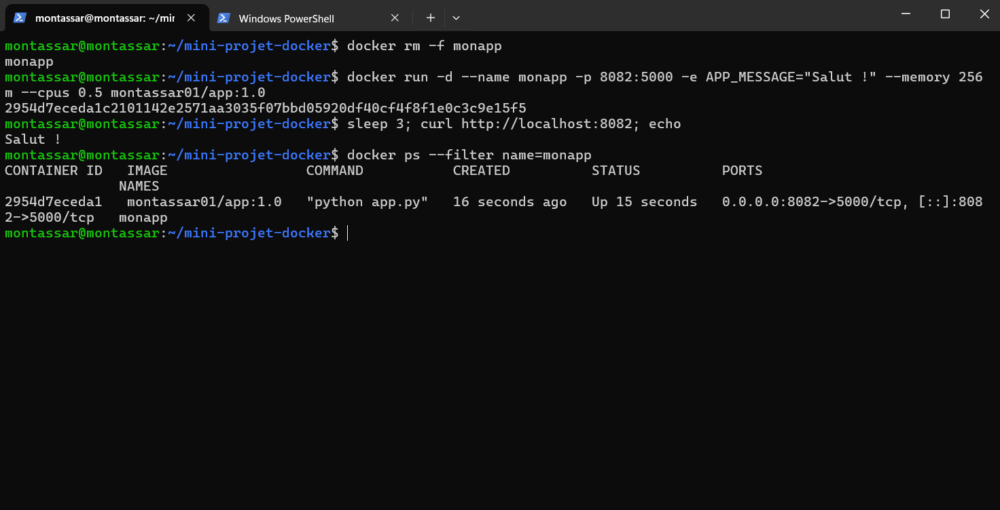

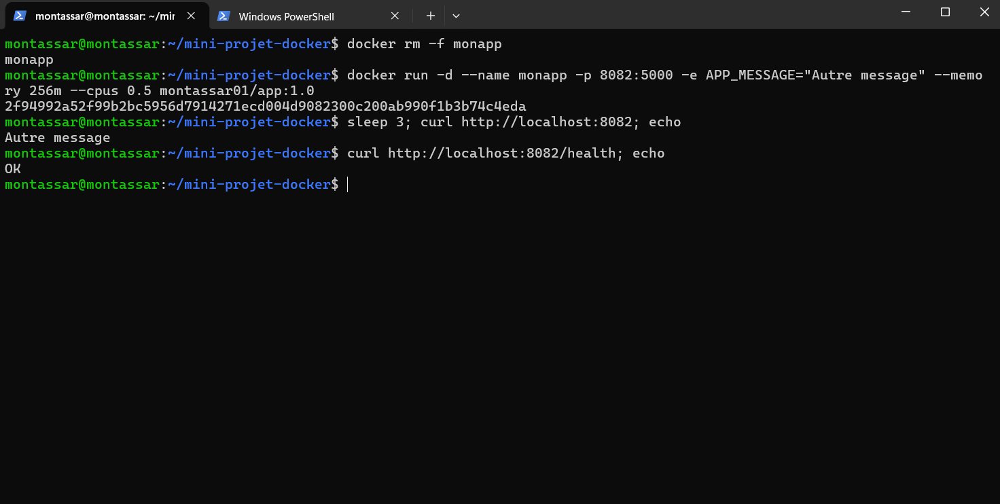

### E7 — Limites de ressources

Configuration vérifiée : mémoire `268435456` octets (256 Mio) et `NanoCpus=500000000` (0,5 CPU). La consommation observée était de `21.59MiB / 256MiB`.

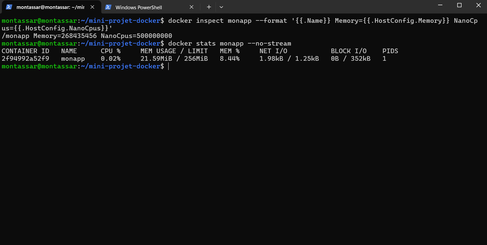

### Étape 4 — Panne et diagnostic

Symptôme : échec de `curl`. Cause racine : fichier `appp.py` inexistant indiqué dans la commande de démarrage.

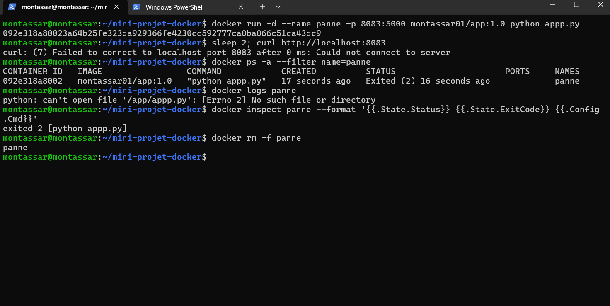

### Étape 5 — Observation du cache

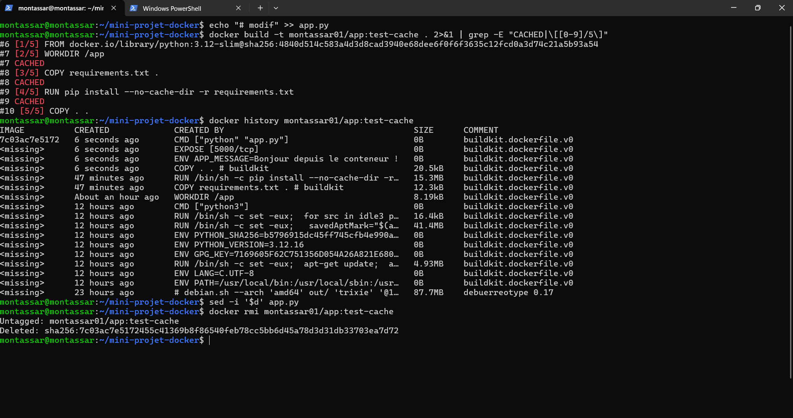

### E8 — Versions et digests

Les tags `1.0` et `1.0.1` partagent le digest d'index `32f95cd0...`, tandis que `1.0.0` possède le digest `1e79b7...`.

Pour la plateforme `linux/amd64`, les préfixes de digest observés sont `ec91a7865a66` pour `1.0` et `1.0.1`, et `c66cfe1ee2f7` pour `1.0.0`.

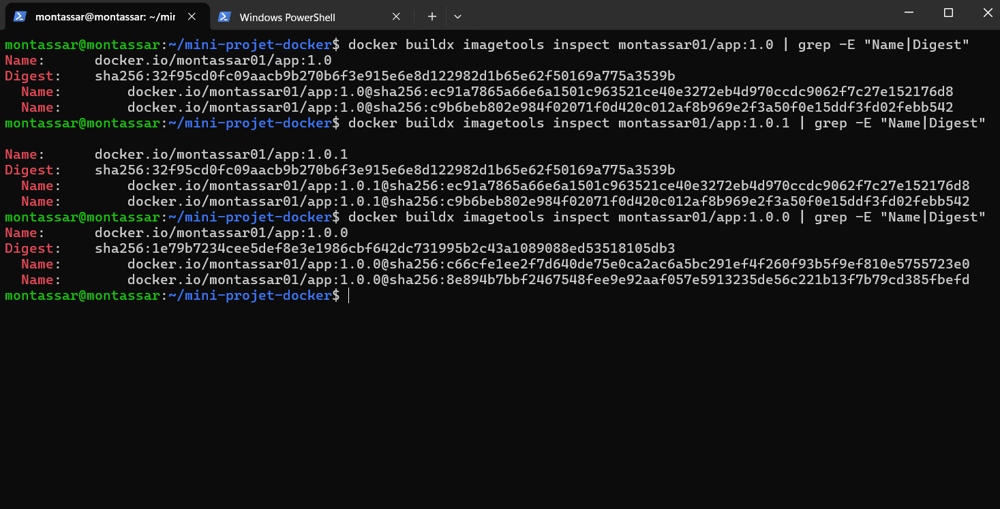

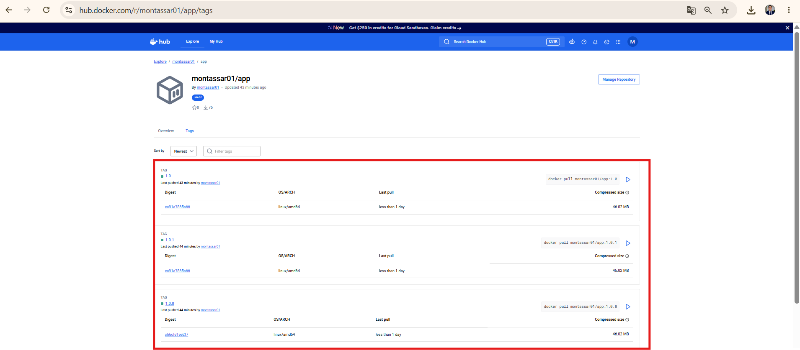

## Annexe — Préparation de l'environnement

Les captures suivantes illustrent les opérations de préparation de l'environnement de travail.

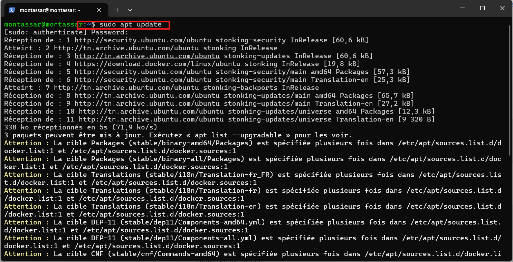

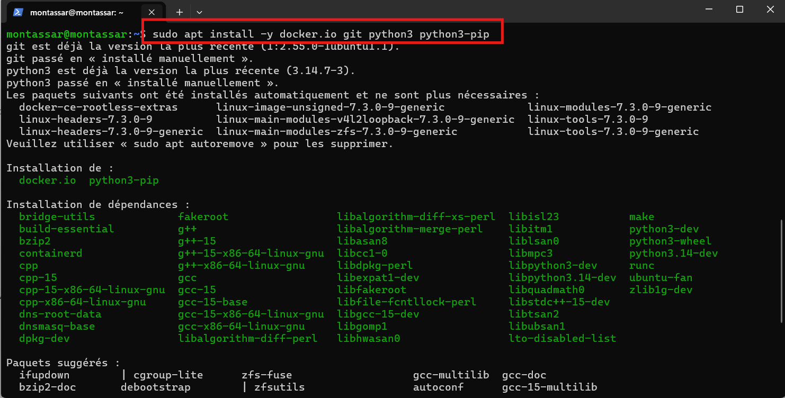

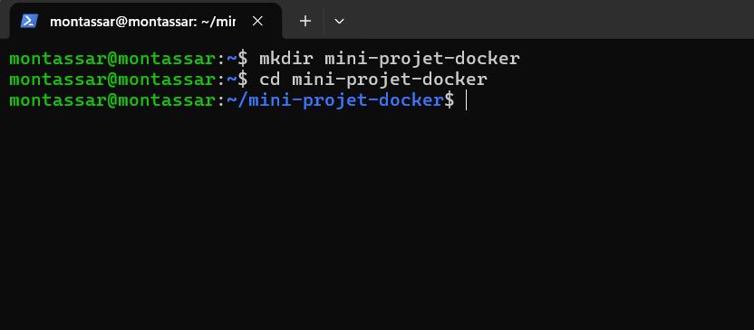

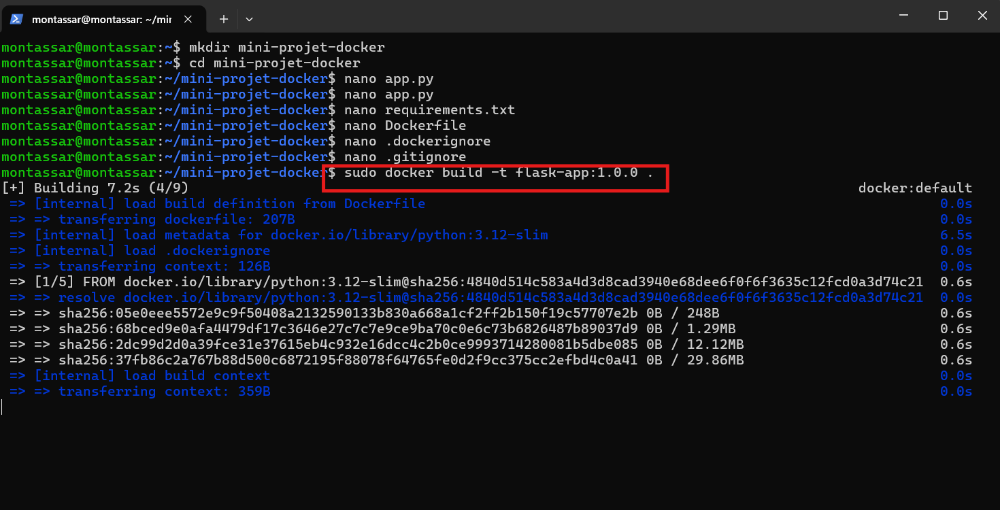

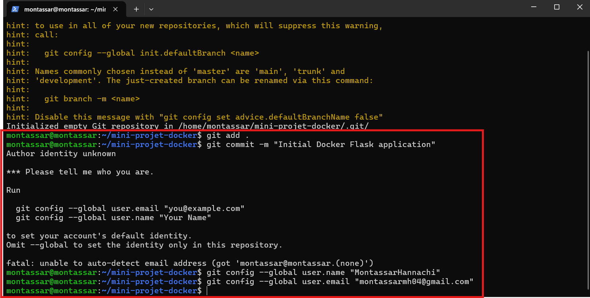

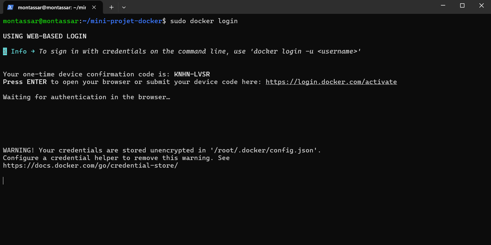

## Captures complémentaires du README

Les quatre captures suivantes sont présentes dans le dépôt et illustrent la documentation et les tests de l'application.

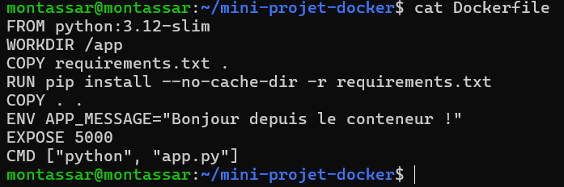

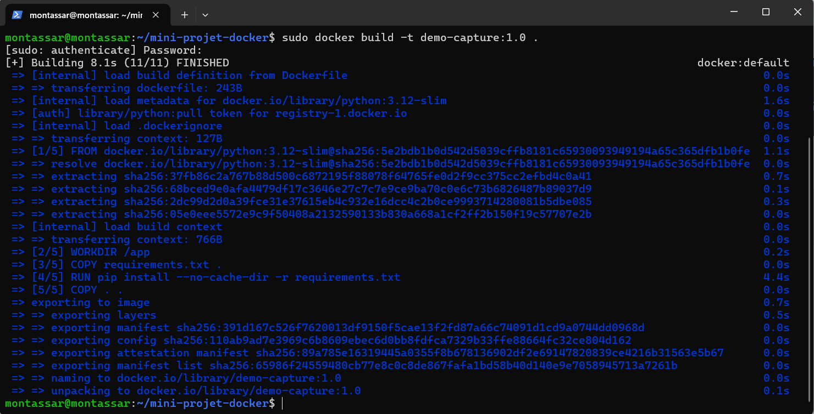

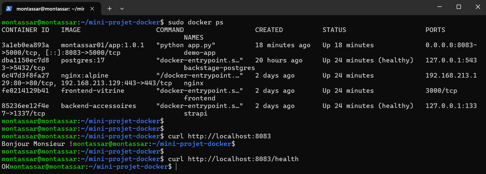

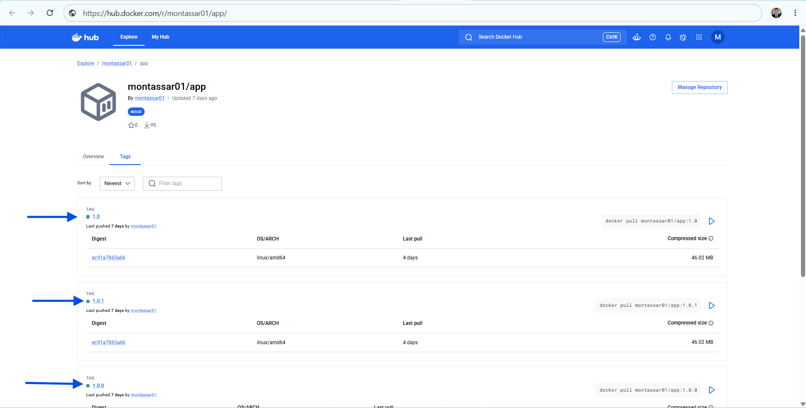

## Conclusion

Ce mini-projet m'a permis de comprendre les principales étapes de la conteneurisation d'une application Flask avec Docker : rédaction du Dockerfile, gestion des variables d'environnement, optimisation du cache, limitation des ressources, diagnostic des erreurs, versionnement des images et publication sur Docker Hub.

Il m'a également permis de mettre en pratique l'utilisation de Git et de rédiger une documentation destinée à faciliter l'exécution du projet par une autre personne.
